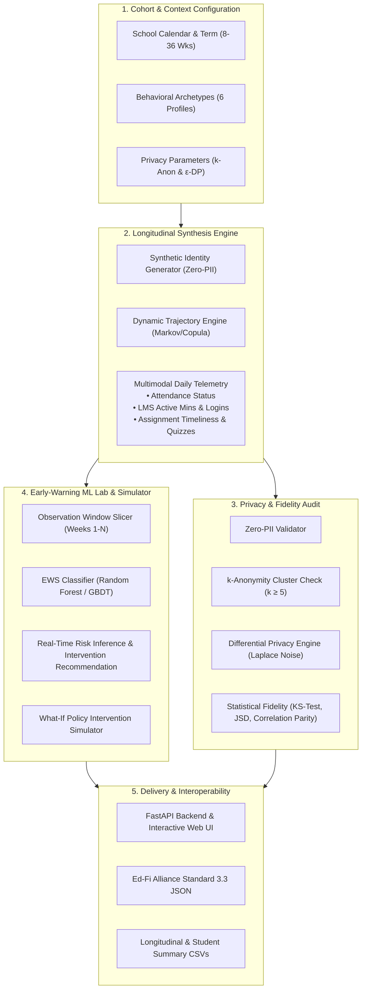

# AttendSynth AI: Synthetic Student Engagement Generator

[](LICENSE)
[](https://www.python.org/downloads/)
[](https://fastapi.tiangolo.com)
[](#privacy-guarantees)
[](#ed-fi-alliance-standard-export)
[](https://github.com/nikhilesh007-code)

**AttendSynth AI** is an enterprise-grade synthetic data generation engine and Early Warning System (EWS) modeling suite for Ed-Tech platforms, K-12 school districts, universities, and educational researchers.

---

## 🎯 The Core Problem & Motivation

Modern educational platforms and institutions want to train **Early Warning Systems (EWS)** that detect student disengagement, chronic absenteeism (>10% instructional days missed), and course failure **2 to 6 weeks in advance**—giving counselors and educators time to intervene proactively.

However:
1. **Strict Privacy Regulations**: Student educational records are legally protected under **FERPA** (Family Educational Rights and Privacy Act), **COPPA**, and GDPR. Sharing or utilizing real student telemetry across external development teams, QA environments, third-party AI vendors, or academic researchers exposes organizations to severe legal and compliance liabilities.
2. **Cold-Start & Data Scarcity**: New educational programs, blended learning schools, and LMS platforms lack historical labeled datasets required to train predictive models.
3. **Class Imbalance & Subtle Dynamics**: Chronic absenteeism and critical disengagement typically affect only 8–18% of the student cohort, and disengagement does not occur abruptly. Real students exhibit leading indicators—such as **spiking tardiness** and **decaying LMS activity**—weeks before failing to attend class.

**AttendSynth AI** bridges this gap by generating **statistically faithful, longitudinally coherent, and mathematically privacy-preserving synthetic student cohorts**.

---

## 🏗️ System Architecture



---

## 🌟 Key Capabilities

### 1. Six Realistic Student Behavioral Archetypes
Students aren't randomly distributed variables; they follow realistic educational trajectories:
- **Consistent High Achiever**: High attendance (~97%), steady LMS telemetry, resilient through exam periods.
- **Gradual Disengager (Primary EWS Target)**: Begins with solid engagement; **LMS active time drops first (weeks 3–5)**, followed by elevated tardiness, before severe unexcused absences begin.
- **Sporadic / High Variance Attendee**: External obstacles (transportation, caregiving); sharp **Monday/Friday absenteeism drops** with midweek recovery.
- **Late-Semester Slumper**: Stable performance until midterm exams (week 8–10), followed by burnout and rapid disengagement.
- **Chronic Absentee**: Sub-75% attendance from early weeks, frequent unexcused absences, low assignment submission.
- **Intervention Responder**: Starts disengaging; an educational intervention at week 8 triggers positive trajectory recovery.

### 2. Multi-Modal Daily Telemetry
For every instructional day across the semester, AttendSynth generates:
- `attendance_status`: `PRESENT`, `TARDY`, `EXCUSED_ABSENCE`, `UNEXCUSED_ABSENCE`
- `lms_active_minutes`: Continuous learning platform telemetry
- `lms_logins`: Frequency of daily logins (Poisson distributed)
- `assignment_submissions`: Timeliness flags (`ON_TIME`, `LATE`, `MISSED`)
- `quiz_scores`: Formative assessment results
- `daily_engagement_score`: Composite 0–100 index

### 3. Enterprise Privacy Guarantees
- **Zero Real-World PII**: Completely non-existent synthetic names, synthetic school codes, and standardized pseudo-identifiers (`SYNTH_STU_XXXX`).
- **k-Anonymity Verification**: Validates that quasi-identifiers meet the threshold $k \ge 5$.
- **Differential Privacy ($\epsilon$-DP)**: Built-in Laplace mechanism that injects calibrated noise $\text{Laplace}\left(0, \frac{\Delta f}{\epsilon}\right)$ when releasing aggregate analytics to external partners.

### 4. Built-in Early Warning System (EWS) Machine Learning Lab
- Trains scikit-learn ensemble models (**Random Forest**, **Gradient Boosting**, **Logistic Regression**) strictly on early observation data (e.g. Weeks 1–6) to predict full-semester Chronic Absenteeism.
- Evaluates **ROC-AUC (typically > 0.90)**, Accuracy, Precision, Recall, Confusion Matrix, and ROC Curve points.
- **Feature Importance**: Proves that early LMS minute decay and tardiness acceleration serve as leading predictive indicators before total absenteeism manifests.
- **Real-Time Inference Sandbox**: Interactive sliders to predict risk probability and recommended interventions for custom student signals.

### 5. What-If Policy Intervention Simulator
Evaluate school district policy actions before spending budget:
- **Automated Guardian SMS Nudges**: Simulates instant text alerts on tardy spikes.
- **Counselor Case Management**: Simulates high-touch outreach for elevated-risk students.
- **Friday Transport Assistance**: Simulates alleviating commute barriers for sporadic attendees.
- Outputs baseline vs post-intervention chronic absenteeism rates and **students saved from academic crisis**.

### 6. Ed-Fi Alliance Standard 3.3 Compatibility
Exports directly into the premier K-12 open data standard:
- `Student`
- `StudentSchoolAssociation`
- `StudentAttendanceEvent`
- Compatible with modern district SIS (Student Information Systems) and Ed-Tech data warehouses.

---

## 🚀 Quickstart

### Installation
Clone the repository and install dependencies:
```bash
git clone https://github.com/nikhilesh007-code/attendsynth.git
cd attendsynth
pip install -e .
```

### Run the Interactive Demo
```bash
python demo.py
```

### Launch the Web UI & API Server
```bash
python -m attendsynth serve --port 8000
```
Then navigate to: **`http://127.0.0.1:8000`**

---

## 💻 Command-Line Interface (CLI)

```bash
# 1. Synthesize a 300-student cohort across 16 weeks
python -m attendsynth generate --students 300 --weeks 16 --preset standard_district --output data/cohort.json

# 2. Train an Early-Warning Machine Learning Model on the synthetic data
python -m attendsynth train --data data/cohort.json --model random_forest --weeks 6

# 3. Audit privacy compliance and statistical fidelity
python -m attendsynth audit --data data/cohort.json

# 4. Export to Ed-Fi standard JSON
python -m attendsynth export --data data/cohort.json --format edfi_json --output data/edfi_students.json

# 5. Launch the Web Studio
python -m attendsynth serve --port 8000
```

---

## 🐍 Python SDK Example

```python
from attendsynth.config import Presets
from attendsynth.generator import AttendSynthGenerator
from attendsynth.models.early_warning import EarlyWarningPredictor
from attendsynth.privacy import PrivacyAuditor

# 1. Generate Cohort
config = Presets.urban_at_risk(num_students=250, seed=42)
generator = AttendSynthGenerator(config)
cohort = generator.generate()

# 2. Privacy Audit
auditor = PrivacyAuditor(k_threshold=5)
privacy_report = auditor.audit_cohort(cohort["students"])
print("Privacy Compliance:", privacy_report["privacy_rating"])

# 3. Train Early Warning System
predictor = EarlyWarningPredictor(model_type="random_forest", observation_weeks=6)
metrics = predictor.train_and_evaluate(cohort)
print(f"EWS ROC-AUC: {metrics['roc_auc']:.4f}")

# 4. Real-Time Risk Scoring
student_early_signals = {
    "early_attendance_rate": 0.86,
    "early_tardy_rate": 0.14,
    "early_unexcused_rate": 0.08,
    "early_avg_daily_lms_minutes": 22.0,
    "early_lms_trend_decay": 0.30,
    "early_submission_rate": 0.70,
    "early_quiz_average": 65.0,
    "baseline_gpa": 2.5,
}
risk = predictor.predict_risk(student_early_signals)
print("Predicted Risk Tier:", risk["predicted_risk_tier"])
print("Recommended Action:", risk["recommended_action"])
```

---

## 🧪 Test Suite

Run the full automated test suite:
```bash
python -m unittest discover -s tests
```
Tests cover:
- Synthetic cohort generator and parameter constraints
- Privacy zero-PII guarantees and k-anonymity validation
- Early-warning ML model training, ROC-AUC benchmarking, and feature importances
- FastAPI REST endpoints, JSON/CSV data exporters, and policy simulation logic

---

## 👤 Author & Maintainer

* **GitHub**: [@nikhilesh007-code](https://github.com/nikhilesh007-code)
* **Repository**: [https://github.com/nikhilesh007-code/attendsynth](https://github.com/nikhilesh007-code/attendsynth)

---

## 📜 License

Apache License 2.0. Built for ethical educational AI development, early-warning prototyping, and student privacy preservation.

