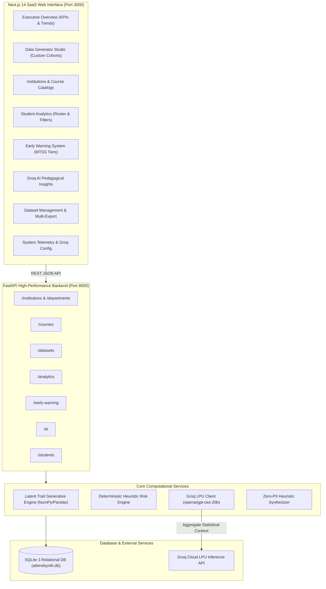

# AttendSynth AI – Synthetic Student Engagement & Academic Early Warning Platform


-emerald.svg)


---

## 🏛️ Executive Summary

Educational institutions, data scientists, and EdTech platforms require realistic longitudinal student engagement data to develop, benchmark, and evaluate Early Warning Systems (EWS) and dropout prevention algorithms. However, real student data is strictly regulated under federal privacy frameworks (**FERPA** in the US, **GDPR** in the EU), making raw student records impossible to freely access or pass to third-party Large Language Models (LLMs).

**AttendSynth AI** solves this dilemma through a **hybrid Generative AI architecture**:
1. **Generative Probabilistic Engine**: Synthesizes multi-week academic cohorts with realistic correlations among attendance, LMS digital telemetry, and assignment grades using **Latent Trait Modeling** ($\theta_i \sim \mathcal{N}(\mu, \sigma^2)$) and autoregressive time-series drift.
2. **Generative Language Engine (Groq LLM)**: Ingests privacy-safe aggregate cohort moments (zero individual PII) to generate deep pedagogical diagnoses and structured Multi-Tiered System of Supports (MTSS) intervention plans.

---

## ⚡ High-Level System Architecture



---

## 🎨 Dual Theme System (Black & Green / White & Green)

AttendSynth AI comes equipped with a custom-engineered dual theme built directly on Tailwind CSS and persistent React context:
- **Dark Theme (Black & Emerald Green)**: Deep obsidian background (`#030712`), rich dark card surfaces (`#090e17`), crisp white typography, and vibrant emerald green accents (`#10b981`).
- **Light Theme (White & Emerald Green)**: Ultra-clean white background (`#f8fafc`), pure white cards (`#ffffff`), dark slate text (`#0f172a`), and emerald green action buttons.
- **Instant Persistence**: Toggled via the header theme button (`Sun` / `Moon`) with zero flash of unstyled content across browser refreshes.

---

## 🎯 The 8 Core Modules

| Module | Route | Key Capabilities |
| :--- | :--- | :--- |
| **Executive Overview** | `/` | Headline KPI cards, 16-week dual-axis trajectory trendlines, engagement distribution donuts, binned attendance charts, priority attention queue, and automated AI executive diagnosis. |
| **Data Generator Studio** | `/generator` | Synthesize academic cohorts (50 to 2000+ STUs, or custom sizes like `60`, `75`) across 6 population profiles (*Balanced, Mostly Engaged, At-Risk Heavy, Positive Drift, Engagement Decay, Multimodal Stress Test*). |
| **Institutions & Courses** | `/curriculum` | Dynamic university taxonomy: multi-tier hierarchy spanning Institutions, Academic Departments, and Course Catalogs with credit allocations. |
| **Student Analytics** | `/analytics` | Interactive student roster with multi-column sorting, search, risk filters, pagination, and a slide-over Student Dossier Drawer with weekly engagement timelines. |
| **Early Warning System (EWS)** | `/early-warning` | Transparent rule-based diagnostic triggers (attendance $< 60\%$, missing assignments, engagement decay), composite risk score, and MTSS 4-week actionable support roadmaps. |
| **Groq AI Insights** | `/ai-insights` | Natural language pedagogical co-pilot powered by Groq LPU inference (`openai/gpt-oss-20b`). Generates MTSS intervention plans and downloadable Markdown reports with zero PII exposure. |
| **Dataset Management** | `/datasets` | Saved cohort persistence in SQLite, cohort activation, in-place renaming, deletion, side-by-side cohort comparative deltas, and multi-format exports (CSV, Weekly CSV, Excel, JSON). |
| **System & API Settings** | `/settings` | Groq API key configuration, model selection, live connection ping latency test, and database storage telemetry. |

---

## 🤖 Generative AI: How & Where It Is Used

AttendSynth AI is engineered around two distinct generative AI pillars:

### 1. Generative Probabilistic Modeling (Data Generation)
- **Engine**: [backend/services/data_generator.py](backend/services/data_generator.py)
- **Technique**: Latent Trait Modeling (Item Response Theory) & Gaussian Mixture Distributions.
- **How It Works**:
  - Each student is assigned an underlying latent motivation variable:
    $$\theta_i \sim \mathcal{N}(\mu, \sigma^2)$$
  - From $\theta_i$, downstream interdependent time-series variables are derived across 4 to 30 weeks:
    - **Weekly Attendance**: $P(\text{attend}_{i,t}) = \sigma(\theta_i - \beta_t + \epsilon_{i,t})$
    - **LMS Telemetry**: Correlated weekly session counts, study hours, and activity logs.
    - **Assignment Grades**: Gaussian performance distributions conditioned on weekly attendance and participation.
- **Why Not an LLM for Rows?**: Using a Large Language Model to output 16,000 tabular numbers would be slow, token-expensive, non-deterministic, and prone to format hallucinations. The probabilistic generative model generates thousands of correlated records instantly with mathematical precision.

### 2. Large Language Model (Pedagogical Reasoning)
- **Engine**: [backend/services/groq_service.py](backend/services/groq_service.py)
- **Hardware/Models**: Groq Cloud LPU acceleration running `openai/gpt-oss-20b` (default) and `qwen/qwen3.8-27b`.
- **Zero-PII Prompt Serialization**:
  - Student names and IDs are **never** transmitted to the cloud.
  - The backend aggregates cohort moments (mean attendance, variance, tier percentages, course difficulty deltas) and prompts the LLM to generate qualitative diagnostics and MTSS intervention roadmaps.
- **Local Fallback**: If offline or rate-limited, an on-device heuristic generator provides instant pedagogical feedback with zero downtime.

---

## 🚀 Quickstart Guide

### 1. Prerequisites
- **Node.js**: v18+ or v20+
- **Python**: 3.10+ (Python 3.11 recommended)
- **Git**

### 2. Installation & Environment Setup

```bash
# Clone the repository
git clone https://github.com/nikhilesh007-code/attendsynth.git
cd attendsynth

# Set up Python backend environment
cd backend
pip install -r requirements.txt
cp .env.example .env   # Add your free Groq API key if available

# Set up Next.js frontend environment
cd ../frontend
npm install
```

### 3. Running the Platform

#### Terminal 1: Start Backend API
```bash
# In project root:
python -m uvicorn backend.main:app --host 127.0.0.1 --port 8000 --reload
```
- **API Swagger Documentation**: [http://127.0.0.1:8000/docs](http://127.0.0.1:8000/docs)
- **Health Check**: [http://127.0.0.1:8000/api/health](http://127.0.0.1:8000/api/health)

#### Terminal 2: Start Next.js Frontend
```bash
# In frontend directory:
cd frontend
npm run dev
```
Open [http://localhost:3000](http://localhost:3000) in your browser.

---

## 🧪 Automated Test Suite

AttendSynth AI includes comprehensive end-to-end and unit test suites:

```bash
python -m unittest discover -s tests -p "test_*.py"
```
```
........................
----------------------------------------------------------------------
Ran 24 tests in 2.133s

OK
```
*Tests verify database initialization, cohort synthesis, student roster filtering, EWS risk scores, analytics distributions, dataset comparisons, and Groq fallback flows.*

---

## 🔒 Privacy & Compliance Disclosure

- **FERPA Zero-PII Guarantee**: All student identities, demographic names, attendance percentages, LMS logs, and marks are generated synthetically. No real student data is ever collected, stored, or transmitted.
- **Explainable Decision Support**: Early Warning risk scores and MTSS tiers reflect transparent, deterministic rules designed to assist educators rather than function as black-box automated penalties.
