# AttendSynth AI – Synthetic Student Engagement & Academic Early Warning Platform


-emerald.svg)

---

## 🏛️ Executive Summary

Educational institutions and EdTech platforms require realistic student engagement datasets to prototype analytics and early warning systems. However, real student records are protected by strict privacy laws (FERPA / GDPR) and are difficult to obtain in volume.

**AttendSynth AI** provides an enterprise-grade synthetic data generation and analytics platform. The application is completely institution-independent and course-independent, supporting dynamic institutions (e.g., SRM University, Horizon Metro), academic departments, customizable course catalogs, latent variable motivation modeling, and explainable multi-tiered academic risk calculations.

---

## ⚡ Architecture & Technology Stack

```mermaid
graph LR
    subgraph Frontend [Next.js 14 TypeScript SaaS Frontend]
        Dashboard[Overview Dashboard]
        Generator[Generator Studio]
        Curriculum[Curriculum & Institutions]
        Analytics[Student Analytics & Roster]
        EWS[Early Warning System]
        GroqUI[Groq AI Insights]
        Sim[Scenario Simulator]
        MLLab[ML Laboratory]
        Datasets[Dataset & Cohort Manager]
    end

    subgraph Backend [FastAPI Backend Service]
        InstRouter[Institutions & Depts CRUD]
        CourseRouter[Dynamic Courses CRUD]
        CohortRouter[Cohort & Dataset Router]
        GenService[Latent Variable Motivation Engine]
        RiskService[Transparent EWS Engine]
        GroqService[Groq Free Tier SDK]
        MLService[Scikit-Learn Benchmarks]
        SimService[What-If Policy Engine]
    end

    subgraph Storage [SQLite Relational Database]
        DB[(attendsynth.db)]
    end

    subgraph AI [Groq Cloud Inference]
        GroqCloud[Groq openai/gpt-oss-20b]
    end

    Frontend -->|REST API / JSON| Backend
    Backend -->|SQLAlchemy ORM| Storage
    Backend -->|Aggregate Zero-PII Context| AI
```



### 1. Frontend
- **Framework**: Next.js 14 with App Router, React 18, TypeScript
- **Styling**: Tailwind CSS with custom Dark Charcoal/Navy SaaS palette (`#090d16`, `#0e1526`, `#6366f1`)
- **Visualizations**: Recharts (Longitudinal line charts, Donut distributions, Course bar charts)
- **Icons**: Lucide React
- **Design Inspiration**: Linear / Vercel / Stripe Dashboard aesthetic with collapsible sidebar, thin borders, and refined hierarchy

### 2. Backend
- **Framework**: Python FastAPI 0.115+
- **Database**: SQLite 3 with SQLAlchemy 2.0 ORM
- **Data Engine**: Pandas & NumPy for multivariate latent Gaussian sampling
- **Synthetic Generator**: Faker with deterministic random seeds
- **Machine Learning**: Scikit-learn (Random Forest & Decision Tree classifiers)
- **AI Co-Pilot**: Official Groq Python SDK with dynamic chat model selection & heuristic fallback

---

## 🚀 Quickstart Guide

### 1. Prerequisites
- **Node.js**: v18+ or v20+ (Node v24 verified)
- **Python**: 3.10+ (Python 3.11 verified)

### 2. Start the Backend API (Terminal 1)
```bash
# In project root: c:\Users\nikhi\attendsynth
python -m uvicorn backend.main:app --host 127.0.0.1 --port 8000 --reload
```
*The backend will automatically create `attendsynth.db` and seed an initial 250-student baseline cohort with 4,000 longitudinal records.*
- **API Documentation**: [http://127.0.0.1:8000/docs](http://127.0.0.1:8000/docs)
- **Health Check**: [http://127.0.0.1:8000/api/health](http://127.0.0.1:8000/api/health)

### 3. Start the Next.js Frontend (Terminal 2)
```bash
# In frontend directory: c:\Users\nikhi\attendsynth\frontend
cd frontend
npm run dev
```
Open [http://localhost:3000](http://localhost:3000) in your web browser.

---

## 🎯 Main Modules & Capabilities

| Module | Description |
| :--- | :--- |
| **Executive Overview** | Headline KPI cards, 16-week longitudinal trendlines, engagement distribution donuts, binned attendance charts, and top priority outreach table. |
| **Data Generator Studio** | Configurable cohort synthesis (50 to 2000 STUs, 4 to 16 weeks) across 4 population profiles (*Balanced, Mostly Engaged, At-Risk Heavy, Random*). |
| **Student Analytics & Roster** | Full cohort table with search, multivariable filtering, sorting, pagination, and slide-in student dossiers showing 16-week time-series histories. |
| **Early Warning System (EWS)** | Transparent rule triggers (<60% attendance, <50% assignments, etc.) and Multi-Tiered System of Supports (MTSS) Tier 1, 2, and 3 intervention plans. |
| **Groq AI Pedagogical Insights** | Privacy-safe cohort diagnostics sending zero PII to Groq Cloud. Generates structured 6-part pedagogical diagnoses and downloadable Markdown reports. |
| **Scenario Policy Simulator** | Interactive what-if policy sliders for attendance, participation, assignments, and LMS usage. Calculates exact counts of students rescued from high risk. |
| **Machine Learning Laboratory** | Scikit-learn Random Forest and Decision Tree classifiers with accuracy, precision, recall, F1, confusion matrix, and feature importances. |
| **Dataset Management** | SQLite persistence, active cohort switcher, cohort renaming, deletion, side-by-side comparison, and CSV / Excel / JSON export. |
| **Settings & Telemetry** | Groq API key configuration, live connection ping, and database health metrics. |

---

## 🔒 Zero-PII Compliance & Scientific Transparency

> [!IMPORTANT]
> **FERPA Compliance**: 100% of student identities, demographic names, attendance percentages, and marks are generated mathematically. No real student data is ever collected, stored, or transmitted.

> [!NOTE]
> **Scientific Disclosure**: High ML benchmark metrics and Early Warning risk scores reflect mathematical reproducibility within the simulated generator equations. They serve as transparent decision-support tools for educators rather than claims of causal predictive certainty.

---

## 🧪 Running the Automated Test Suite

```bash
python -m unittest tests/test_fullstack.py
```
*All 8 end-to-end integration tests verify database initialization, cohort synthesis, student filtering, EWS rules, analytics distributions, what-if simulations, ML models, and dataset comparisons.*
