# 🎓 AttendSynth AI: Synthetic Student Engagement Generator

[](https://www.python.org/downloads/)
[](https://streamlit.io/)
[](https://groq.com/)
[](#privacy-guarantees)
[](LICENSE)

**AttendSynth AI** is a professional, full-stack educational data generation engine and Early Warning System (EWS) modeling suite. Designed to look and operate like an enterprise SaaS analytics product, AttendSynth AI synthesizes realistic, longitudinally coherent, and privacy-preserving student engagement datasets.

---

## 🎯 The Core Problem & Motivation

Modern educational platforms, K-12 school districts, and university systems want to build predictive **Early Warning Systems (EWS)** to identify students vulnerable to disengagement, course failure, or chronic absenteeism **weeks before final exams**.

However, developing these systems faces three fundamental roadblocks:
1. **Strict Privacy Regulations (FERPA & COPPA)**: Real student education records and telemetry are legally protected. Sharing or using real student PII in research, testing, or EdTech prototyping exposes organizations to severe legal liability.
2. **Cold-Start & Data Scarcity**: New educational programs, blended learning schools, and digital LMS platforms lack historical labeled datasets required to train predictive models.
3. **Complex Trajectory Dynamics**: Student disengagement is not a sudden binary event; students exhibit subtle leading indicators—such as **decaying LMS active time**, **increasing Monday/Friday tardiness**, and **late homework submissions**—weeks before failing to attend class.

**AttendSynth AI** bridges this gap by generating **statistically faithful, correlated, and mathematically privacy-preserving synthetic student cohorts**, pairing statistical simulation with **Groq ultra-fast LPU inference**.

---

## 🏗️ System Architecture

```mermaid
flowchart TD
    subgraph Config ["1. Cohort Configuration"]
        A1["Cohort Size (50 - 2000 STUs)"]
        A2["Instructional Term (4 - 16 Weeks)"]
        A3["Population Profile (Balanced / Mostly Engaged / At-Risk Heavy)"]
        A4["Random Seed (100% Reproducibility)"]
    end

    subgraph Generator ["2. Core Synthesis Engine"]
        B1["Fictional Identity Engine (Faker / Zero-PII)"]
        B2["Latent Motivation Modeling (Multivariate Normal)"]
        B3["Longitudinal Trajectory Synthesizer (Improving / Stable / Declining)"]
        B4["Correlated Multimodal Indicators<br/>• Attendance % • In-Class Participation<br/>• Assignment Completion • LMS Logins • Assessment Marks"]
    end

    subgraph AnalyticalModules ["3. Analytical & AI Services"]
        C1["Transparent Early Warning System (EWS Rules)"]
        C2["Scikit-learn ML Lab (Random Forest & Decision Tree)"]
        C3["Interactive Scenario Simulator (What-If Policy Shifts)"]
        C4["Groq LPU LLM Engine (Llama 3.3 70B Diagnostics)"]
    end

    subgraph Frontend ["4. Dark Navy SaaS Dashboard"]
        D1["Executive KPI Cards & Badges"]
        D2["Interactive Plotly Charts (Distributions & Trajectories)"]
        D3["Individual Student Deep-Dive & Comparison Inspector"]
        D4["Multi-Format Export Center (CSV, JSON, Multi-Sheet Excel)"]
    end

    Config --> Generator
    Generator --> AnalyticalModules
    AnalyticalModules --> Frontend
```



---

## 🚀 Key Modules & Capabilities

### 1. 📊 Executive Overview Dashboard
- High-level KPI metric cards: Total Generated Students, Mean Attendance %, Composite Engagement Score, High/Medium/Low engagement counts, and High-Risk Learner tallies.
- Interactive Plotly visualizations:
  - **Composite Engagement Score Distribution** (Histogram color-coded by tier)
  - **Attendance Distribution** with 60% Critical EWS Cutoff indicator
  - **Academic Risk Tier Breakdown** (Donut chart with custom SaaS styling)
  - **Longitudinal Trajectories** across instructional weeks with bold cohort mean
  - **Course-Wise Performance Benchmarks**

### 2. ⚙️ Synthetic Data Generator Studio
- Configurable cohort sizes: **50, 100, 250, 500, 1000, 2000** students.
- Configurable semester terms: **4, 8, 12, 16** weeks.
- Enrolled course selection: Computer Science, Data Science, Linear Algebra, Academic Writing, Molecular Biology.
- Four distinct **Population Behavioral Profiles**:
  - `Balanced engagement`: Standard bell curve across all performance tiers.
  - `Mostly engaged students`: High-achiever cohort with elevated attendance and participation.
  - `At-risk-heavy population`: Stressed cohort with elevated disengagement and chronic absence.
  - `Random distribution`: Wide variance across all metrics.
- 100% reproducible statistical synthesis using random seeds.

### 3. 🔍 Student Analytics & Deep-Dive Explorer
- Search students by **Name** or **Student ID**.
- Filter by Course, Engagement Tier, or Risk Level.
- **Single Student Inspector**: View complete academic telemetry and individual weekly trajectory sparklines.
- **Side-by-Side Comparator**: Compare two students' attendance, LMS logins, and scores simultaneously.
- **Multidimensional Correlation**: Interactive scatter plot comparing attendance versus participation colored by risk.

### 4. 🚨 Transparent Early Warning System (EWS)
- Transparent rule-based indicators identifying vulnerable learners:
  - Attendance $< 60\%$
  - In-Class Participation $< 40\%$
  - Assignment Completion $< 50\%$
  - Failing Assessment Marks $< 50\%$
  - Chronic Late Submissions ($\ge 4$)
  - Multi-Week Longitudinal Engagement Decay
- Prioritized support roster with explicit trigger reasons.
- Actionable Multi-Tiered System of Supports (MTSS) recommendations (Universal, Targeted, Intensive).

### 5. 🤖 Groq AI Insights Co-Pilot
- Powered by the **official Groq Python SDK** and **Llama 3.3 70B** running on Groq LPUs at 500+ tokens/second.
- **Zero-PII Compliance**: Transmits strictly aggregate dataset statistics (cohort size, mean attendance, risk proportions, course averages) rather than individual raw student records.
- Preset one-click diagnostic prompts:
  - *"Why are students showing disengagement?"*
  - *"Analyze major attendance patterns and at-risk groups."*
  - *"Which engagement factors are most critical?"*
  - *"What MTSS interventions could improve participation?"*
  - *"Executive Cohort Summary & Risk Analysis"*
- Custom natural language question interface.
- Automatic heuristic offline fallback if an API key is not yet configured.

### 6. 🔮 What-If Policy & Scenario Simulator
- Interactive simulation sliders adjusting:
  - Attendance shift ($\Delta$: -30% to +30%)
  - Participation shift ($\Delta$: -30% to +30%)
  - Assignment completion shift ($\Delta$: -30% to +30%)
  - LMS digital activity shift ($\Delta$: -50% to +50%)
- Live Before-and-After outcome metrics:
  - Projected Attendance and Engagement change
  - **Count of students rescued from High-Risk classification**
  - Relative risk reduction percentages

### 7. 🧠 Machine Learning Lab
- Benchmarks **Random Forest** and **Decision Tree** classifiers on synthetic features.
- 80/20 stratified train/test split.
- Performance evaluation: **Accuracy, Precision, Recall, and F1-Score**.
- Interactive Plotly **Confusion Matrix Heatmap**.
- Feature Importance ranking bar chart proving that early LMS decay and assignment submission serve as leading predictive indicators.

### 8. 📥 Dataset Export & Download Center
- Download the live generated dataset in multiple formats:
  - **Flat Student Cohort CSV** (`attendsynth_students.csv`)
  - **Longitudinal Weekly Time-Series CSV** (`attendsynth_weekly_timeseries.csv`)
  - **Multi-Sheet Excel Workbook** (`attendsynth_complete_dataset.xlsx`) with formatted sheets for Students, Weekly Telemetry, and Course Analytics.
  - **JSON Format** (`attendsynth_students.json`)

---

## 💻 Installation & Quickstart

### 1. Prerequisites
- Python 3.9, 3.10, 3.11, or 3.12 installed.

### 2. Clone the Repository & Install Dependencies
```bash
git clone https://github.com/organization/attendsynth.git
cd attendsynth
pip install -r requirements.txt
```

### 3. (Optional) Configure Groq API Key
AttendSynth AI works completely out of the box with offline heuristic fallbacks. To enable ultra-fast LPU AI reasoning:
1. Obtain a free API key at **[console.groq.com/keys](https://console.groq.com/keys)**.
2. Either create a `.env` file from `.env.example`:
   ```bash
   cp .env.example .env
   # Add your key inside .env: GROQ_API_KEY=gsk_...
   ```
3. Or simply paste the key into the input field in the **Groq AI Insights** page inside the web application!

### 4. Run the Streamlit Application
```bash
streamlit run app.py
```
Then open your browser to: **`http://localhost:8501`**

---

## 🧪 Automated Test Suite

Run the full automated test suite covering statistical generation, rule evaluation, ML benchmarking, scenario simulator, and exports:
```bash
python -m unittest tests/test_stream_app.py
```
*(All 10 unit tests run and pass in ~1.5 seconds).*

---

## 📁 Project File Structure

```
attendsynth/
├── app.py                     # Main Streamlit router & shared state manager
├── requirements.txt           # Project dependencies
├── .env.example               # Template for Groq API key configuration
├── .gitignore                 # Git ignore rules
├── README.md                  # Comprehensive documentation
├── core/                      # Modular backend engines
│   ├── __init__.py            # Package exports
│   ├── data_generator.py      # Correlated multivariate synthetic cohort generator
│   ├── risk_engine.py         # Transparent rule-based Early Warning System
│   ├── analytics.py           # Statistical aggregations and course metrics
│   ├── scenario_simulator.py  # What-If policy intervention simulator
│   ├── ml_model.py            # Scikit-learn Random Forest & Decision Tree classifier
│   ├── ai_insights.py         # Groq API Llama 3.3 70B integration with fallback
│   ├── visualizations.py      # Custom dark navy Plotly chart library
│   └── views.py               # Modular view components for each page
├── pages/                     # Streamlit multi-page interface files
│   ├── 1_📊_Dashboard.py
│   ├── 2_⚙️_Data_Generator.py
│   ├── 3_🔍_Student_Analytics.py
│   ├── 4_🚨_Early_Warning.py
│   ├── 5_🤖_AI_Insights.py
│   ├── 6_🔮_Scenario_Simulator.py
│   ├── 7_🧠_Machine_Learning.py
│   └── 8_📥_Export_Data.py
├── styles/                    # SaaS Design System
│   └── theme.py               # Dark navy CSS injection & KPI card renderers
├── tests/                     # Automated test suites
│   └── test_stream_app.py     # Unit tests verifying all core components
└── data/                      # Output directory for exported CSV, Excel, and JSON
```

---

## 📜 Scientific & Ethical Disclaimers

1. **Synthetic Nature**: All student identities, scores, telemetry records, and names generated by AttendSynth AI are 100% fictional. No real student personal records or PII are used or exposed.
2. **Predictive Transparency**: The Early Warning System and Machine Learning modules are designed for prototyping, research, and algorithmic benchmarking. Performance on synthetic data should not be interpreted as evidence of real-world clinical or diagnostic efficacy without validation against sanctioned institutional benchmarks.

---

## 📄 License

Apache License 2.0. Built for ethical educational AI development, early-warning prototyping, and student privacy preservation.
